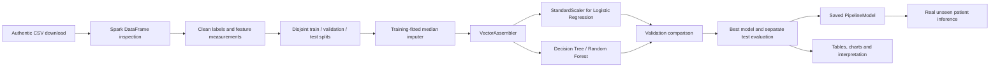

# Healthcare Disease Prediction

Assignment 3 implements a complete diabetes prediction pipeline with Apache Spark DataFrames and Spark MLlib. It prepares authentic historical patient records, fits Logistic Regression, Decision Tree and Random Forest models, compares their accuracy, positive-class precision, recall and F1, selects the best model using validation results, and predicts outcomes for supplied patient records.

## Assignment objective and problem

A healthcare organization wants to predict whether a patient is likely to have diabetes from historical measurements. The implementation uses the Pima Indians Diabetes dataset suggested in the screenshot. Its target records whether the patient tested positive for diabetes. The coursework model learns that observed target from eight numerical predictors.

The complete extracted assignment, deliverables, submission fields and interpretations are recorded in `docs/assignment_requirements.md`. The model comparison uses separate training, validation and test sets to keep the final evaluation independent of model selection.

## Technologies and prerequisites

- Python 3.10 through 3.12, with Python 3.11 recommended for a new environment.
- Java 17 with `JAVA_HOME` pointing to its installation and `java` available on `PATH`.
- Apache Spark through `pyspark==3.5.3`.
- Spark MLlib `Pipeline`, `Imputer`, `VectorAssembler`, `StandardScaler`, `LogisticRegression`, `DecisionTreeClassifier` and `RandomForestClassifier`.
- Matplotlib for charts and pytest for validation.
- Internet access for dependency installation or optional dataset reacquisition. The training pipeline works offline once these are available.

No Hadoop cluster or separate Spark installation is needed for the default `local[2]` run. Two local worker threads demonstrate Spark execution. A Spark cluster can be used through `--master` with compatible Spark and Java versions and shared dataset/output paths.

## Project architecture



`python main.py train` connects every stage. Deterministic feature cleaning is shared between training and inference, and the saved model contains its training-fitted statistical preprocessing stages.

## Folder structure and important files

```text
Assignment_3/
├── README.md
├── submission.md
├── requirements.txt
├── main.py
├── Dockerfile
├── .dockerignore
├── .gitignore
├── pytest.ini
├── scripts/download_dataset.py
├── data/README.md
├── data/raw/README.md
├── src/
│   ├── data.py
│   ├── csv_validation.py
│   ├── models.py
│   ├── evaluation.py
│   └── artifacts.py
├── pipeline/pipeline.py
├── docs/
│   ├── assignment_requirements.md
│   ├── methodology.md
│   ├── project_explanation.md
│   └── validation.md
├── outputs/README.md
└── tests/
    ├── test_evaluation.py
    ├── test_csv_validation.py
    ├── test_source_validation.py
    └── test_spark_pipeline.py
```

`src/data.py` reads, audits and cleans real records and creates repeatable splits. `src/models.py` builds all three required Spark pipelines. `src/evaluation.py` computes confusion counts and class-1 metrics. `src/artifacts.py` saves aggregate reports and figures. `pipeline/pipeline.py` connects the pipeline and saved-model inference. `scripts/download_dataset.py` downloads and validates the authentic source. `main.py` provides the command-line entry point.

## Dataset and source

The Pima Indians Diabetes source contains 768 historical records, eight numerical predictors and one binary target. The source cohort consists of female Pima Indian patients aged at least 21. The original owner was the National Institute of Diabetes and Digestive and Kidney Diseases. Vincent Sigillito donated the dataset in 1990. Its accompanying dictionary describes the original study and field meanings.

- Authentic public CSV mirror, with no header, is [pima-indians-diabetes.data.csv](https://raw.githubusercontent.com/jbrownlee/Datasets/master/pima-indians-diabetes.data.csv).
- The original accompanying dictionary is [pima-indians-diabetes.names](https://raw.githubusercontent.com/jbrownlee/Datasets/master/pima-indians-diabetes.names).
- The mirror repository is [jbrownlee/Datasets](https://github.com/jbrownlee/Datasets).

The public mirror does not specify a dataset redistribution license. The project includes the authentic public source file and its source attribution. The mirror's licensing uncertainty is recorded in the dataset documentation. UCI's current dataset 34 describes a different AIM '94 time-series Diabetes dataset, so its license is not applied to this Pima source.

The included `data/raw/03_Dataset.csv` contains the complete authentic 768-record source and is 23,278 bytes. Its bytes match the public mirror. The submission filename changes the name only, and its headerless CSV contents are preserved. The download script can validate the included file or reacquire it at the same path. `data/README.md` explains all fields, missing-value handling and manual placement. The acquisition script writes the real source unchanged and saves a provenance JSON with the URL, shape, size and SHA-256 digest. The full source dataset is packaged. The inference demonstration is generated during training. The training command creates its inference demonstration from actual held-out records.

## Installation and environment setup

Open this folder in VS Code, Antigravity or another IDE. Run commands from the folder containing `main.py`.

PowerShell on Windows, with Python and Java already installed

```powershell
python -m venv .venv
.\.venv\Scripts\Activate.ps1
python -m pip install --upgrade pip
python -m pip install -r requirements.txt
java -version
python scripts/download_dataset.py
```

Linux or macOS

```bash
python3 -m venv .venv
source .venv/bin/activate
python -m pip install --upgrade pip
python -m pip install -r requirements.txt
java -version
python scripts/download_dataset.py
```

If PowerShell blocks activation, use `.venv\Scripts\python.exe` directly for each command. The Docker option provides a Linux Spark environment when native Windows Hadoop file-system utilities are unavailable.

## Run the complete pipeline

```bash
python main.py train
```

Every path defaults to this project directory, so invoking `main.py` from another working directory also works. Explicit paths are resolved from the current working directory.

```bash
python main.py train --input data/raw/03_Dataset.csv --output outputs --master "local[2]" --partitions 2 --seed 42
```

For a custom training CSV with a header, use the exact columns documented in `data/README.md` and add `--header`. Increase `--partitions` and supply a Spark master URL for distributed execution with shared storage.

### Predict patient records with the saved model

Training writes a small CSV of genuine held-out features with the labels removed. It loads the saved model again and writes predictions for those records.

```bash
python main.py predict --input outputs/results/demo_patients.csv
```

For your own patient file

```bash
python main.py predict --input data/my_patients.csv --model outputs/models/best_model --output outputs
```

The patient CSV requires the eight predictor column names. An optional `PatientID` column is retained. `Outcome` is unnecessary for inference. The predicted class and probability of class 1 are generated for every supplied row. The probability is the fitted model's estimate for the source target.

### Docker execution

```bash
docker build -t assignment3 .
docker run --rm --entrypoint python -v "${PWD}/data:/app/data" assignment3 scripts/download_dataset.py
docker run --rm -p 4040:4040 -v "${PWD}/data:/app/data" -v "${PWD}/outputs:/app/outputs" assignment3 train
```

The commands use Docker Desktop's Linux container mode on Windows. Create the image after installing Docker Desktop. Mounted `data` and `outputs` preserve inputs and results on your computer.

## Pipeline details

1. Load the authentic CSV as a Spark DataFrame and display its schema and first records.
2. Count missing, nonnumeric, nonfinite, negative, zero-missing and cohort-invalid measurements. Save the audit.
3. Remove invalid targets, canonicalize numeric measurements, convert invalid features to null, and remove canonical feature/target duplicates. The audit counts both original exact duplicates and canonical duplicates.
4. Split records by a canonical feature-only content hash into approximate 60% training, 20% validation and 20% testing. Equal feature records share one split even when their labels differ. Save membership and verify both classes exist in every split.
5. Fit a median `Imputer` on training records only. Assemble the eight imputed columns into a Spark feature vector.
6. Scale the Logistic Regression vector using a training-fitted `StandardScaler`. Train Decision Tree and Random Forest on the assembled vector.
7. Evaluate each model on validation data. Select the highest positive-class F1, with validation accuracy and stable model name as tie breakers.
8. Evaluate all three fitted models on the separate test set. Save accuracy, class-1 precision, recall, F1 and confusion counts.
9. Persist the selected training-fitted Spark `PipelineModel`. Generate comparison charts and an interpretation report from the real metrics.
10. Export actual held-out features as demonstration patients. Reload the saved model and save their predictions.

The split and cleaning policies, metric formulas and distributed processing explanation are described in `docs/methodology.md`.

## Expected outputs and saved locations

Outputs are generated when you run the pipeline. Their values depend on the actual input and run configuration.

| Location under `outputs/` | Contents |
| --- | --- |
| `reports/data_quality.json` | Counts and cleaning policy for missing/invalid records |
| `processed/cleaned_records/` | Cleaned Spark CSV, before statistical imputation |
| `results/splits/` | Record membership and observed labels for each split |
| `results/performance_comparison.csv` and `.json` | Validation and test metrics for all three models |
| `results/test_predictions/<model>/` | Observed test labels, predicted classes and probabilities |
| `figures/model_comparison.png` | Test accuracy, precision, recall and F1 chart |
| `figures/class_distribution.png` | Actual cleaned class counts |
| `models/best_model/` | Persisted Spark PipelineModel |
| `models/model_metadata.json` | Feature contract, source digest, split counts and selection rule |
| `results/demo_patients.csv` | Genuine held-out features with labels removed |
| `results/new_patient_predictions/` | Predicted classes and probabilities for demonstration or supplied patients |
| `reports/results_interpretation.md` | Brief interpretation generated from measured results |
| `reports/execution_plans/` | Spark plans for each model's test transformations |
| `reports/run_summary.json` | Configuration, source fingerprint and real metrics |
| `spark-events/` | Spark event logs for execution inspection |

Spark CSV output locations are directories containing `part-*.csv` files and `_SUCCESS`. This preserves distributed writing. The two small aggregate tables and demonstration file are ordinary single CSV files. A rerun replaces tables and the best model at the requested output location. Event logs retain individual applications. Use `--output outputs/run2` to retain a previous run.

## Spark UI and distributed execution

```bash
python main.py train --ui-hold-seconds 180
```

Open the printed Spark UI URL, commonly `http://localhost:4040`, while the application is running. Inspect Jobs, Stages, Executors and SQL. Event logs remain available after Spark stops and can be loaded by a Spark History Server configured to read `outputs/spark-events`.

Spark reads and transforms partitioned DataFrames. Imputation and scaling compute distributed statistics. Logistic Regression aggregates gradient information across workers, and tree models build splits from distributed feature summaries. Workers transform partitions for prediction. The chosen partitions and UI describe the actual execution. The small Pima dataset demonstrates these APIs and cannot establish large-cluster scaling measurements.

## Validation commands

```bash
python -m compileall main.py src pipeline scripts tests
python -m unittest tests.test_evaluation tests.test_source_validation tests.test_csv_validation
python -m pytest -m "not integration"
python -m pytest -m integration
```

The standard-library unittest command checks metric formulas, zero-denominator handling, model-selection ties, CSV widths and acquisition validation without Spark or pytest installed. It also checks the authentic source shape when the downloaded file is present. The same tests run through pytest. The Spark integration check uses the authentic downloaded source and requires Spark and Java. It verifies disjoint splits, canonical numeric deduplication, missing-value handling and unchanged predictions after saving and loading the Logistic Regression pipeline. `docs/validation.md` records what was actually checked during packaging.

## Troubleshooting and limitations

- A missing dataset error includes the expected path and acquisition command. Download manually from the documented URL if your network blocks the script.
- A `JAVA_GATEWAY_EXITED` error usually means Java is missing or `JAVA_HOME` is invalid. Verify Java 17 before launching the pipeline.
- Native Windows Spark may report `winutils.exe` or Hadoop native-library file-system errors. Use the included Docker Linux environment or WSL with Java 17 for execution.
- A missing feature error lists the required CSV columns. Training headers require exact order. Patient headers require the eight exact predictor names.
- A split lacking one class or a feature containing no valid training observations fails with an informative error. Supply the full dataset or adjust the seed for another input.
- The cohort is historically and demographically limited. Fixed hyperparameters provide a reproducible coursework baseline, and the project does not claim clinical validation.
- A Spark cluster needs matching Spark/Python dependencies and shared file paths visible to the driver and workers. The default local run uses your machine's available threads.
- Use `submission.md` to review the GitHub repository, source ZIP and dataset submission links. The source attribution and licensing uncertainty appear in `data/README.md`.
